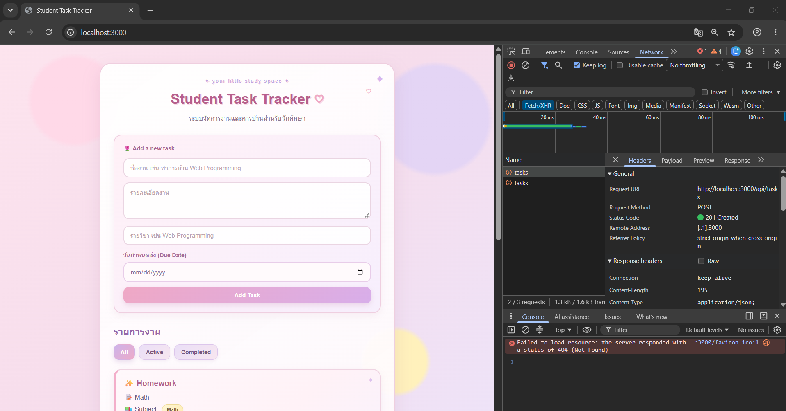
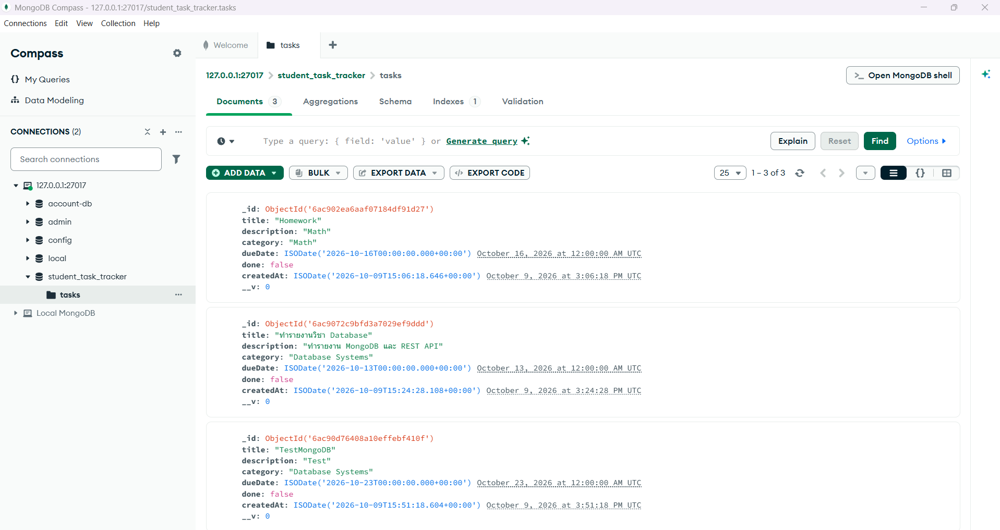

# 🌷 Student Task Tracker

เว็บแอปพลิเคชันสำหรับจัดการงานและการบ้านของนักศึกษา พัฒนาด้วย **Node.js, Express.js, HTML, CSS และ JavaScript** โดยใช้ **MongoDB** เป็นฐานข้อมูล และ **Mongoose** สำหรับติดต่อกับฐานข้อมูล

ผู้ใช้สามารถเพิ่ม ดู แก้ไข ลบ และกรองรายการงานได้โดยไม่ต้องรีเฟรชหน้าเว็บ เนื่องจาก Frontend เรียก REST API ด้วย `fetch()`

## ✨ Features

- เพิ่ม Task พร้อมชื่องาน รายละเอียด รายวิชา (Subject) และวันกำหนดส่ง (Due Date)
- แสดง Task ทั้งหมดที่บันทึกใน MongoDB
- แก้ไขรายละเอียด Task และวันกำหนดส่ง
- เปลี่ยนสถานะระหว่าง **Active** และ **Completed**
- ลบ Task
- กรองรายการตาม **All / Active / Completed**
- อัปเดตหน้าเว็บผ่าน `fetch()` โดยไม่ต้องโหลดหน้าใหม่

> **หมายเหตุ:** ในโค้ดและฐานข้อมูล ใช้ฟิลด์ `category` เพื่อเก็บชื่อรายวิชา (Subject) โดยคงชื่อฟิลด์เดิมจากโปรเจกต์ To-Do List

## 🛠️ Technologies

- **Frontend:** HTML, CSS, JavaScript
- **Backend:** Node.js, Express.js
- **Database:** MongoDB (Local), Mongoose
- **Development:** Nodemon

## 📁 Project Structure

```text
student-task-tracker/
├── public/
│   ├── index.html
│   ├── style.css
│   └── app.js
├── server/
│   ├── models/
│   │   └── Task.js
│   ├── routes/
│   │   └── tasks.js
│   ├── db.js
│   └── server.js
├── screenshots/
│   ├── debug-1.png
│   └── debug-2.png
├── .gitignore
├── package.json
├── package-lock.json
└── README.md
```

> ปรับแผนผังให้ตรงกับไฟล์ในโปรเจกต์จริงก่อนส่ง หากยังมีโฟลเดอร์หรือไฟล์อื่นอยู่

## ⚙️ Installation

**สิ่งที่ต้องมี:** Node.js, npm และ MongoDB Server ที่ติดตั้งและทำงานอยู่ในเครื่อง (MongoDB Compass เป็นโปรแกรมเสริมสำหรับดูข้อมูล)

1. ดาวน์โหลดหรือ Clone โปรเจกต์ แล้วเปิดโฟลเดอร์ใน VS Code
2. เปิด Terminal ที่โฟลเดอร์หลักของโปรเจกต์
3. ติดตั้ง Dependencies:

   ```bash
   npm install
   ```

4. ตรวจสอบว่า MongoDB Server ทำงานอยู่ และเชื่อมต่อผ่าน Connection String:

   ```text
   mongodb://127.0.0.1:27017
   ```

   แอปกำหนดชื่อฐานข้อมูลเป็น `student_task_tracker` และ Collection เป็น `tasks`

## ▶️ Running the Application

รันโปรเจกต์ด้วยคำสั่ง:

```bash
npm run dev
```

เมื่อเชื่อมต่อสำเร็จ ควรเห็นข้อความลักษณะนี้ใน Terminal:

```text
MongoDB connected successfully
Server is running on http://localhost:3000
```

จากนั้นเปิดเบราว์เซอร์ที่ **http://localhost:3000**

## 🔌 REST API Endpoints

Base URL: `http://localhost:3000`

| Method | Endpoint | Description |
|---|---|---|
| `GET` | `/api/tasks` | ดึง Task ทั้งหมด |
| `GET` | `/api/tasks?done=false` | ดึงเฉพาะ Task ที่ยังไม่เสร็จ (Active) |
| `GET` | `/api/tasks?done=true` | ดึงเฉพาะ Task ที่เสร็จแล้ว (Completed) |
| `GET` | `/api/tasks/:id` | ดึง Task ตาม ID |
| `POST` | `/api/tasks` | เพิ่ม Task ใหม่ |
| `PATCH` | `/api/tasks/:id` | แก้ไข Task หรือเปลี่ยนสถานะ |
| `DELETE` | `/api/tasks/:id` | ลบ Task |

### Example: Create Task

**Request:** `POST /api/tasks`

```json
{
  "title": "ทำรายงานวิชา Database",
  "description": "จัดทำรายงานเกี่ยวกับ MongoDB",
  "category": "Database Systems",
  "dueDate": "2026-10-20"
}
```

ฟิลด์ `done` มีค่าเริ่มต้นเป็น `false` สำหรับ Task ใหม่

### Example: Update Task

**Request:** `PATCH /api/tasks/:id`

```json
{
  "done": true
}
```

## 🗄️ Database

- **Database:** `student_task_tracker`
- **Collection:** `tasks`
- **Main fields:** `title`, `description`, `category`, `dueDate`, `done`, `createdAt`
- MongoDB กำหนด `_id` ให้แต่ละ Task โดยอัตโนมัติ และ API ส่งชื่อฟิลด์ `id` ให้ Frontend ใช้งาน


## Debugging Evidence

### 1. REST API Testing

ทดสอบการเพิ่ม Task ผ่าน REST API ด้วย HTTP POST
และตรวจสอบผ่าน Chrome DevTools
พบว่าเซิร์ฟเวอร์ตอบกลับด้วยสถานะ 201 Created



### 2. MongoDB Database

ตรวจสอบข้อมูลผ่าน MongoDB Compass
พบว่าข้อมูล Task ถูกจัดเก็บในฐานข้อมูล
student_task_tracker ภายใน Collection tasks

